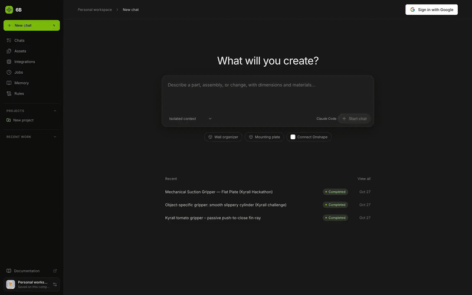
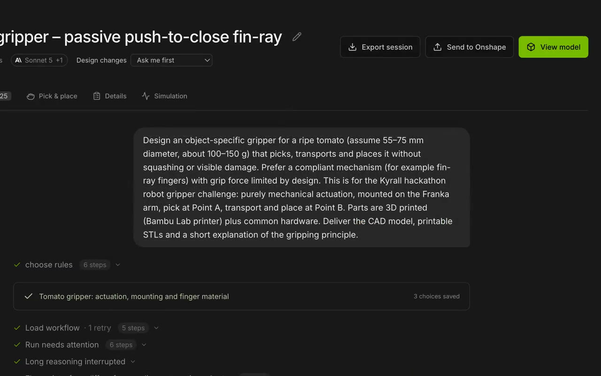
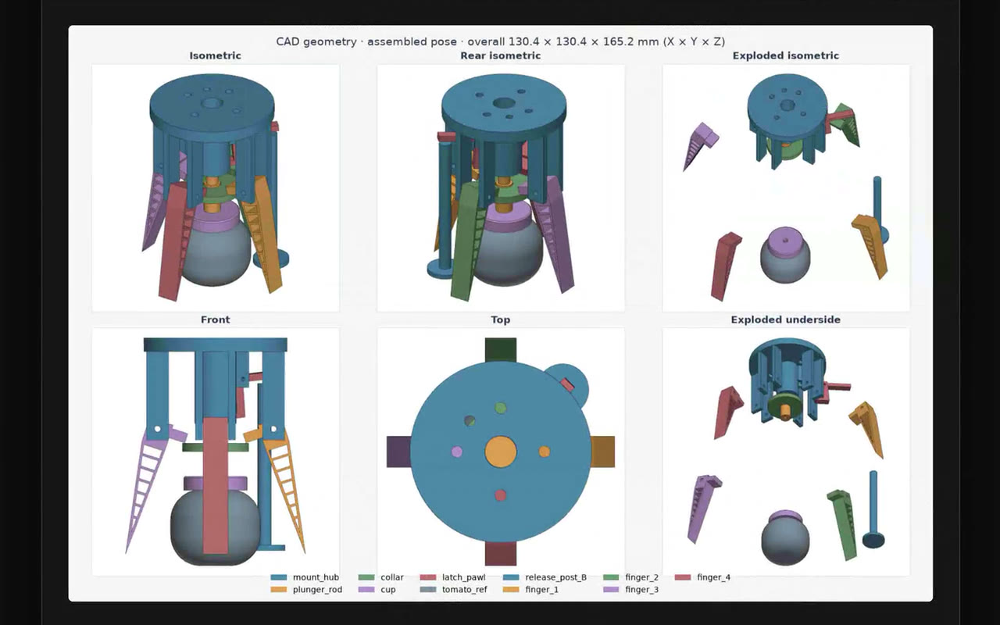
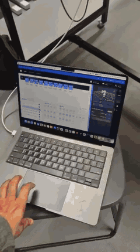
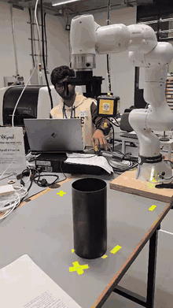

<div align="center">

# 6B

**Describe a part. Get validated, printable CAD.**

6B is an AI engineering workspace. You describe a part or mechanism in plain language. 6B asks
what matters, writes parametric CAD, checks the geometry, and hands back STEP and STL files you
can print, with every decision and source on record.

[**Live app**](https://6b.up.railway.app) · [Backend](backend/README.md) · [Frontend](frontend/README.md) · [API reference](https://6b.up.railway.app/docs)



</div>

## From prompt to printed part

Built for the Kyrall × Franka robot-gripper hackathon: these grippers were designed in 6B,
printed on a Bambu Lab printer and mounted on a Franka FR3 arm.

<table>
  <tr>
    <td width="33%"></td>
    <td width="33%"></td>
    <td width="33%"></td>
  </tr>
  <tr>
    <td align="center"><b>1. Brief</b><br><sub>Plain language, with the dimensions that matter</sub></td>
    <td align="center"><b>2. Plan</b><br><sub>Changes, fixed parts and risks, approved before building</sub></td>
    <td align="center"><b>3. Checked CAD</b><br><sub>Rendered views the model reviews before it answers</sub></td>
  </tr>
</table>

<p align="center">
  
  &nbsp;
  
</p>

## What it does

- **Chat to CAD.** The model writes a CadQuery script with lofts, sweeps, shells and patterns
  on the OpenCascade kernel. You get STEP, one STL per part, and the script itself.
- **Checks before answers.** Every build is tested for valid solids, watertight meshes, overlaps,
  STEP re-import and print-bed fit. The final answer waits for passing checks, and a failure
  sends the model back to repair it.
- **3D studio.** Explode, isolate and measure parts, scrub motion studies, and change design
  values with sliders. Each slider rebuild is a new validated version and needs no model call.
- **Questions and approvals.** 6B asks one to three questions when a choice matters, and shows a
  plan before it changes an existing design.
- **Evidence on record.** Decisions name their basis, such as a fetched datasheet page, a
  measurement or your answer. Files are versioned and hashed.
- **Real tools.** Import from and send to Onshape, slice in Bambu Studio, plan pick-and-place, and
  observe or export scenes for NVIDIA Isaac Sim.
- **Your choice of model.** Claude Code (Opus 5.5 or Sonnet 5.5) or OpenAI (GPT-6 Astra,
  GPT-6.1 Sol or Terra), with a reasoning-effort slider. An offline workshop mode needs no model.

<p align="center">
  
</p>

## Quick start

Needs Python 3.11+ (3.12 tested) and Node.js 20+.

```sh
./install.sh   # Python venv, frontend packages, backend/.env
./start.sh     # builds the UI and serves everything
```

Open **http://127.0.0.1:8765**, then connect a model under **Integrations → Model provider**:

| Provider | Setup |
|---|---|
| Claude Code | `claude auth login` once on this computer, or paste an Anthropic API key |
| OpenAI | `OPENAI_API_KEY` and `6B_MODEL` in `backend/.env`, or sign in with a ChatGPT plan |
| Workshop | Nothing. Offline examples (marker organizer, mounting plate) |

## Deploy

The live app runs on [Railway](https://railway.com) as two services from this repo:

| Service | Root | What it is |
|---|---|---|
| `backend` | `/backend` | Flask API and CAD workers ([Dockerfile](backend/Dockerfile)). Set `6B_HOSTED=1` and `OPENAI_API_KEY` |
| `frontend` | `/frontend` | Built React app served by Caddy, which proxies `/api` to `BACKEND_URL` ([Dockerfile](frontend/Dockerfile)) |

In hosted mode each visitor signs in with Google and brings their own model connection. If the
site has its own OpenAI key, every visitor's OpenAI chats run on it. See
[backend/README.md](backend/README.md#deploy) for every variable.

## Repository

```
backend/        Flask API, model adapters, CAD kernel, tools, tests, docs
frontend/       React 19 + Vite workspace, 3D studio, tests
chat-history/   Transcripts of the build sessions
media/          README images and GIFs
```

Run every check (backend tests, frontend tests and the production build) with:

```sh
./verify.sh
```

> [!NOTE]
> Geometry checks are real, but they don't prove physical fit, strength or print success.
> Treat a design as a strong first draft and test it on the bench.
