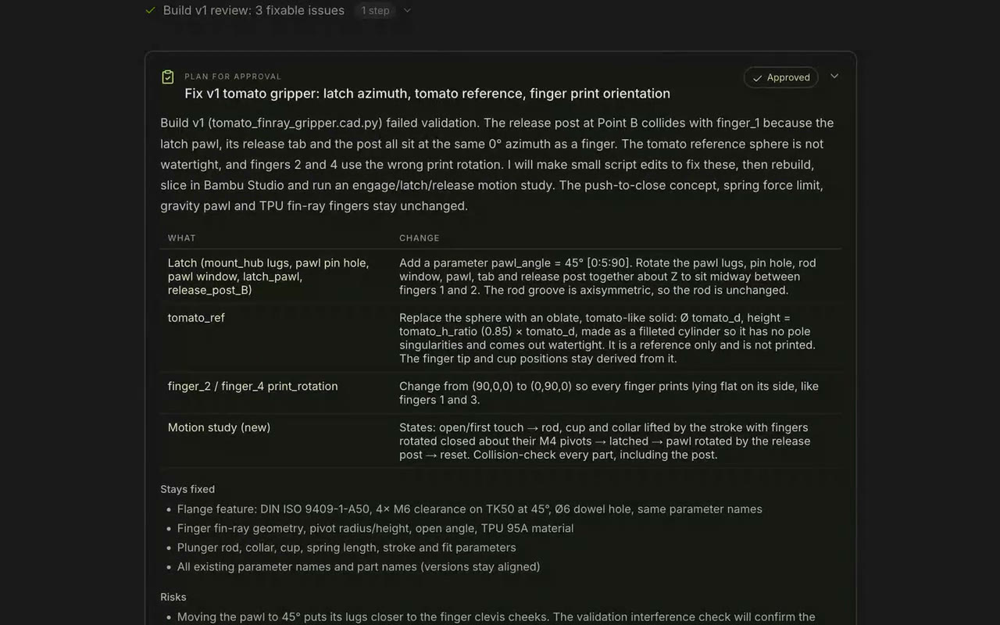
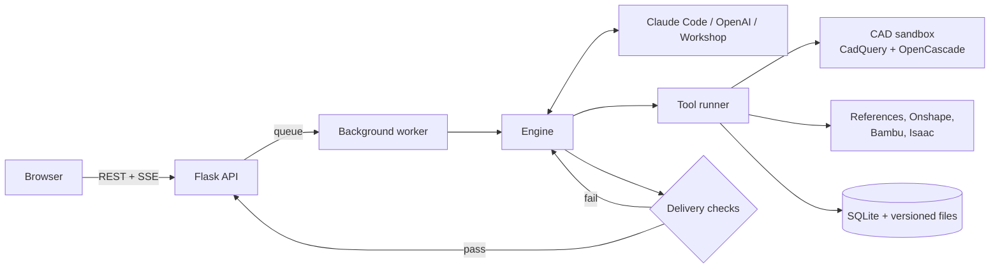

# 6B backend

The engine behind 6B: a Flask API that runs model-driven engineering sessions, compiles CAD on
the OpenCascade kernel, checks every build, and keeps a versioned, hash-checked record of each
file and decision.



## Run it

From the repository root:

```sh
./install.sh   # .venv, Python packages, frontend build, backend/.env from .env.example
./start.sh     # serves the API and the built UI on http://127.0.0.1:8765
```

API reference is at **/docs**, OpenAPI at **/openapi.json**. Python 3.11+ is required (3.12 is
tested). The CAD kernel makes the install much larger than a typical web app.

To run the API on its own:

```sh
cd backend
../.venv/bin/python run.py
```

## How a run works



1. A message queues a run. A worker in its own thread claims it under a lease, so a crash leaves
   it retryable, not lost.
2. The engine gives the model 6B's typed tools and nothing else. In Claude Code mode the built-in
   shell, file and web tools, hooks, plugins and other MCP servers are all removed.
3. Tools validate arguments, run within time and size limits, and persist results. A tool error
   comes back to the model with a repair hint instead of ending the run.
4. Before the final answer, delivery checks confirm current validation, exports, decision
   evidence and packaging. A failure gets up to three repair turns.
5. Every step streams to the browser as durable events, which survive a reconnect.

## Model providers

| Provider | `6B_PROVIDER` | Connects through | Models |
|---|---|---|---|
| Claude Code | `claude` | [Claude Agent SDK](https://docs.claude.com/en/docs/agent-sdk/overview) and the signed-in account, or `ANTHROPIC_API_KEY` | Opus 5.5, Sonnet 5.5 (xhigh effort) |
| OpenAI | `openai` | Responses API with `OPENAI_API_KEY`, or a ChatGPT plan sign-in | GPT-6 Astra, GPT-6.1 Sol, GPT-6.1 Terra |
| Workshop | `workshop` | Nothing. Deterministic offline examples | None |

You can switch in the app under **Integrations → Model provider**. The choice is saved in
`data/integrations/model.json` and overrides `.env` from then on. OpenAI chats also choose a
reasoning effort (`low` to `xhigh`) in the composer.

## Tools the model can call

| Area | Tools |
|---|---|
| CAD | `build_cad_script` (preferred), `revise_cad_script`, `build_cad`, `revise_cad`, `inspect_validation`, `inspect_image` |
| Mechanisms | `evaluate_motion`, `record_design_review` |
| Manufacturing and sim | `slice_with_bambu`, `export_isaac_scene` |
| Conversation | `ask_questions`, `request_approval`, `update_plan`, `set_specification`, `activity` |
| Evidence | `record_decision`, `fetch_reference`, `choose_rules`, `record_rule_checks` |
| Files and memory | `write_document`, `read_artifact`, `list_artifacts`, `package_artifacts`, `search_context`, `save_memory`, `load_workflow` |

Model-written CAD scripts may import only `cadquery` and `math`. They run with restricted
builtins under CPU and file-size limits. On macOS they also run under `sandbox-exec`, with no
network and writes confined to the build folder.

## Configuration

Copy [`.env.example`](.env.example) to `.env` (`./install.sh` does this). The variables that
matter most:

| Variable | Default | Purpose |
|---|---|---|
| `6B_PROVIDER` | `workshop` | Starting provider: `claude`, `openai` or `workshop` |
| `OPENAI_API_KEY` | | OpenAI key (`OPENAI_KEY` also works) |
| `6B_MODEL` | | OpenAI model; hosted mode falls back to `gpt-6.1-terra` |
| `6B_REASONING_EFFORT` | `medium` | Default OpenAI effort when a chat names none |
| `6B_CLAUDE_MODEL` | Opus 5.5 | `claude-opus-5-5` or `claude-sonnet-5-5` |
| `6B_CLAUDE_TIMEOUT` | `600` | Seconds per Claude Code run (`1200` for complex work) |
| `6B_MAX_RUN_TOKENS` | `200000` | Soft token ceiling per run, including cached input |
| `6B_TOOL_TIMEOUT` | `180` | Seconds per tool call |
| `6B_DATA_DIR` | `./data` | SQLite database, files, saved connections |
| `6B_REFERENCE_DOMAINS` | | Domains `fetch_reference` may read; empty means none |
| `6B_API_TOKEN` | | Optional bearer token for a local API |
| `ONSHAPE_ACCESS_KEY` / `ONSHAPE_SECRET_KEY` | | Onshape import and export (or connect in the app) |
| `6B_ISAAC_*` | | Read-only observer for an existing Isaac Sim container over SSH |

## Deploy

[`Dockerfile`](Dockerfile) builds the API image. On Railway, set the service's root directory
to `/backend`, attach a volume for `6B_DATA_DIR`, and set:

| Variable | Value |
|---|---|
| `6B_HOSTED` | `1`: each browser brings its own connection; server-wide Anthropic keys are ignored |
| `6B_HOST`, `6B_BEHIND_PROXY` | `*` and `1`: listen on all interfaces and trust Railway's proxy |
| `6B_ALLOWED_HOSTS` | The public host names |
| `OPENAI_API_KEY` | Optional site key. Every OpenAI chat runs on it, and visitors pick only the model and effort |
| `FIREBASE_SERVICE_ACCOUNT`, `FIREBASE_WEB_API_KEY`, `FIREBASE_AUTH_DOMAIN`, `FIREBASE_APP_ID` | Google sign-in and a cloud copy of each chat |
| `6B_OWNER_EMAIL` | The admin account that may change workspace-wide settings |

Browser keys travel only with requests that start a run. The server holds them in memory for that
task and never writes them to the database, events or logs.

## API at a glance

| Endpoint | Purpose |
|---|---|
| `POST /api/tasks`, `POST /api/tasks/{id}/messages` | Start a chat or send a follow-up |
| `GET /api/tasks/{id}/events` | Server-sent event stream with a resumable cursor |
| `POST /api/tasks/{id}/questions/{q}/answer`, `POST /api/tasks/{id}/approvals/{a}` | Answer questions, approve plans |
| `GET /api/tasks/{id}/artifacts/{a}/content` | Download a file version |
| `POST /api/tasks/{id}/artifacts/{a}/rebuild` | Rebuild a CAD script from slider values, without a model call |
| `GET /api/tasks/{id}/audit`, `GET /api/tasks/{id}/tools/{call}` | Tool history, sources, decisions, delivery checks |
| `POST /api/onshape/import`, `POST /api/onshape/export` | Onshape round trip |
| `GET /api/capabilities`, `GET /api/health` | Active provider, model, effort and limits |

The full list, with schemas, is at `/docs`.

## Tests

```sh
cd backend
../.venv/bin/python -m pytest -q
```

The suite covers real CAD export and re-import, mesh integrity, artifact versioning, worker
recovery, auth and origin checks, hosted key handling, both model adapters, and the tool
protocol. `./verify.sh` at the root runs these plus the frontend checks.

## Code map

| Path | Responsibility |
|---|---|
| `app/main.py`, `app/api.py` | Routes, validation, OpenAPI, SSE, access and origin checks |
| `app/runtime.py`, `app/db.py` | Worker lifecycle; SQLite schema, leases and event log |
| `app/engine.py`, `app/completion.py` | Run loop and delivery checks |
| `app/provider.py`, `app/claude_code.py`, `app/chatgpt.py` | OpenAI Responses, Claude Agent SDK and ChatGPT plan adapters |
| `app/connections.py`, `app/credentials.py` | Saved model connections; browser-held keys in hosted mode |
| `app/tools.py`, `app/tool_protocol.py` | Tool registry and the shared call boundary |
| `app/cad_script.py`, `app/cad_worker.py`, `app/motion_worker.py` | CAD sandbox, compiler and exports, motion checks |
| `app/artifacts.py` | Immutable versions, SHA-256, ZIP manifests |
| `app/onshape.py`, `app/bambu.py`, `app/simulation.py` | Integrations |
| `app/firebase.py`, `app/rules.py` | Google sign-in and cloud sync; rules |
| `app/prompts/` | Orchestrator, CAD, research, manufacturing, review and communication prompts |

## More detail

- [Reference](docs/REFERENCE.md): every feature in depth, including photos to CAD, Onshape,
  sliders, approvals, evidence, Isaac and operating limits.
- [Architecture](docs/ARCHITECTURE.md): components, state machine, contracts.
- [Verification](docs/VERIFICATION.md): what the checks prove and what they don't.
- [Image, CAD and simulation](docs/IMAGE_CAD_SIMULATION.md): evaluation record.

The prompts were written independently from observed workflows. No private prompts or server
code were used.
