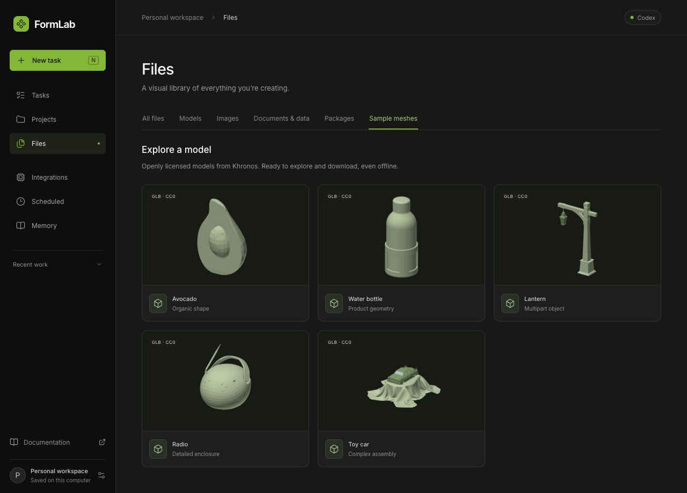
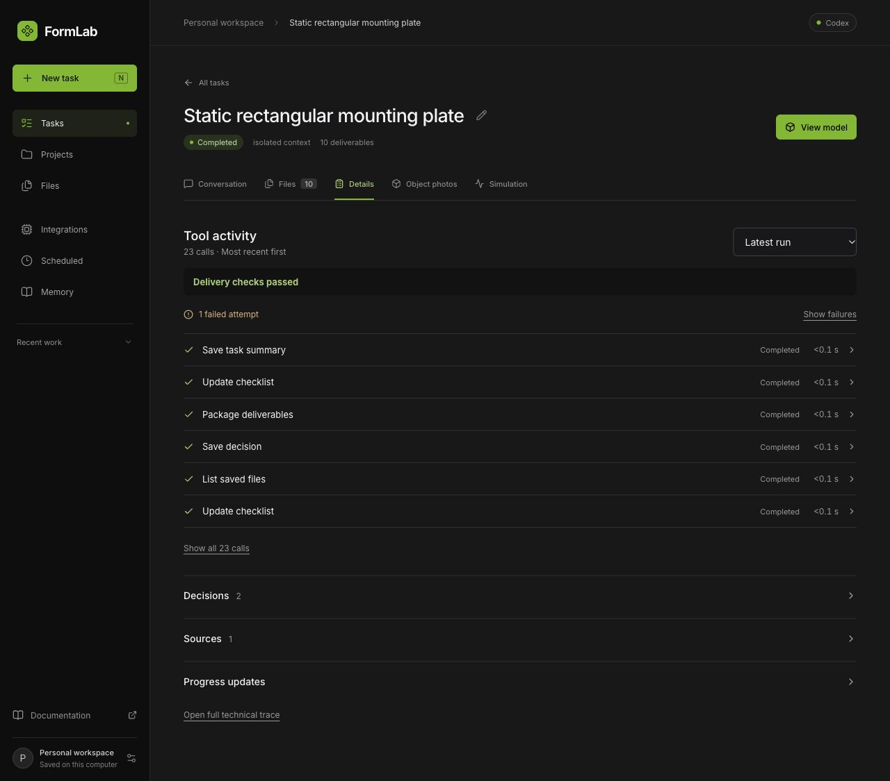
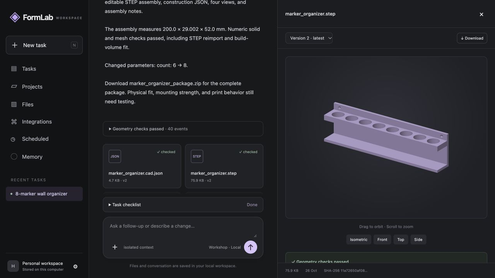

# Verification record

## Web mesh library and camera framing — 26 October 2026

The full backend suite passed **91 tests in 74.52 seconds**, with the existing
CadQuery export deprecation warning. The nine new mesh tests passed again after
the final front-axis alignment change. `npm --prefix frontend run check` passed
**5 Node tests and 49 React tests** plus the production build.

The offline library includes five CC0 models from pinned Khronos sources:
Avocado, WaterBottle, Lantern, BoomBox and ToyCar. Backend tests verify original
GLB bytes, all preview and source-notice hashes, triangle indices, finite
coordinates, source transforms and repeated instances, unit conversion, unknown
IDs, authentication, origin checks and tampered files. Browsing creates no tasks
or runs. UI tests cover Files navigation, source/license links, focus restoration,
failed catalogue retries, failed downloads, authenticated original downloads and
mesh-format classification. Camera tests check full-orbit framing and tiny models.

Live browser checks opened all five models in the existing app. Verified keyboard
orbit/zoom, reset, part isolation, maximum part separation, turntable, original
Avocado download and model details. The radio's antenna exposed an old camera
framing problem: fitting only the longest axis clipped rotated geometry. A bounding
sphere now keeps the model within the reset viewport through every orientation.
Single-part reference meshes omit assembly controls; references do not claim CAD
validation. Textures and materials remain in the original GLB downloads.

Verified the 611 px app-panel layout (document and dialog scroll widths both
611 px), with no browser errors or warnings. The viewport override was reset.
The temporary test server was stopped and the idle main server restarted with
the new endpoints. Existing saved tasks were retained.

## Minimal tool activity interface — 26 October 2026

`npm --prefix frontend run check` passed **5 Node tests and 32 React tests** and
the production build. Seven new UI cases verify the conversation-to-details
navigation, latest-run tracking, failed-attempt history, nested technical
disclosures, readable untrusted source text, missing audit data, and stopped
tool states. Existing workspace and model-studio changes were preserved.

Browser checks used the saved completed evaluation run, with its 23 tool calls,
one failed attempt, two decisions, and one fetched source. Verified failure
filtering, lazy tool details, source artifact/version navigation, and the readable
saved extract. The details screen fit both the default desktop viewport and the
611 px app-panel width with no horizontal document overflow; no console errors
were observed. The temporary viewport override was reset. No new model run was
started for this UI change.

The conversation now offers one compact status row leading to **Details**.
Tool calls show the six latest attempts first; decisions, sources, progress
updates, and raw payloads expand on demand. The latest delivery check is prominent,
and earlier checks remain inspectable without mislabeling a repaired run as failed.

## Tool-call reliability — 26 October 2026

`./verify.sh` passed **82 backend tests in 78.72 seconds**, **5 Node tests and
18 React tests**, syntax checks, and the production build. The same existing
CadQuery assembly-export deprecation warning remains.

New cases cover malformed and duplicate-key JSON, nonfinite numbers,
bounded oversized argument records, repair continuation, field-level errors,
disabled capabilities, task/run ownership, in-flight replay protection, user
cancellation and cleanup, tool/run deadlines, rejected-call budget accounting,
and replacement of unavailable tools. Provider responses for these cases are
scripted; this increment made no live model calls.

## Workflow and evidence extension — 26 October 2026

The final `./verify.sh` run passed **65 backend tests in 71.78 seconds**, **5 Node
tests and 18 React tests**, JavaScript syntax checks, and the Vite production build.
The combined suite includes the image/simulation work being developed in the same
checkout; those changes were preserved. One existing CadQuery deprecation warning
was emitted by its assembly export helper.

Browser verification opened the completed Evidence view, expanded a failed tool call
to inspect arguments/results, and opened the exact saved source version. The test
workspace was separate from the user's main application data.

- [Verified interface](evidence/workflow-evidence.png)

The gripper extension passed **44 backend tests in 55.23 seconds** and **2 frontend
tests** on 26 October 2026. Added checks cover collisions between clear endpoints,
measured gaps, whole-tool travel versus relative motion, current-build closure gates,
PDF bounds, actual image payloads, provenance, targeted edits and stale/failed ZIP
rejection, the complex-assembly CPU regression, and incomplete macOS font discovery.

Verified locally on 26 October 2026. This record describes the implemented system,
not the private internals of the reference portal.

## Automated checks

The original baseline passed **23 tests in 14.87 seconds**. The Flask extension
adds lifecycle, streaming, and frontend escaping checks. Run `./verify.sh` from
the repository root to repeat the suite and JavaScript syntax checks.

The final extended run passed **31 backend tests in 14.35 seconds**, plus **2 frontend
formatting/escaping tests**.

Coverage includes real CAD generation and STEP reimport, watertight mesh checks,
rejection of disconnected geometry, immutable revisions, ZIP checksums, request
idempotency, question ownership and resumption, queued follow-ups, cancellation,
expired worker leases, scoped memory, project context, local authentication and
origin checks, and provider-tool continuation and repair.

Unit tests use controlled provider responses. The Claude Code adapter is covered by
scripted protocol tests, and the direct API adapter remains mock-tested.

## Browser walkthrough

The connected local interface was exercised through a fresh six-marker request,
the mounting/orientation/material questionnaire, completed geometry generation,
and a follow-up changing the count to eight while retaining the previous answers
and keeping width below 210 mm. The model preview was opened from the STEP card.
Switching between version 1 and version 2 visibly restored the six-hole and
eight-hole geometry respectively. The API reference also loaded from the running
server's OpenAPI schema.

## Included output

`../examples/marker_organizer_package.zip` contains the actual eight-marker build,
including STEP, STL, construction JSON, SVG views, validation, assembly notes, and
a checksum manifest. The construction JSON and validation report are also stored
beside the ZIP for easy inspection.

- Assembly envelope: **200 × 29.002 × 52 mm**.
- Printable mesh: one connected solid, 4,276 triangles, watertight and consistently wound.
- Positive volume, valid boundary representation, and successful STEP reimport.
- Print orientation envelope: 200 × 52 × 29 mm; fits the specified printer bed.
- No overlapping assembly parts (this example has one part).

This geometry is an independent implementation. Its dimensions and construction
are not an exact reconstruction of the reference output. Numerical validation
does not establish physical fit, strength, fatigue, printing success, or kinematics.
See [the parity matrix](PARITY_MATRIX.md) for the full implementation boundary.
