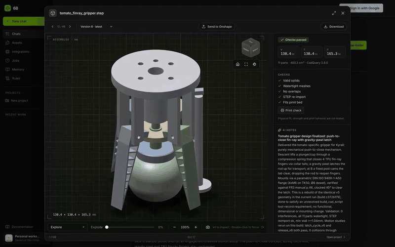
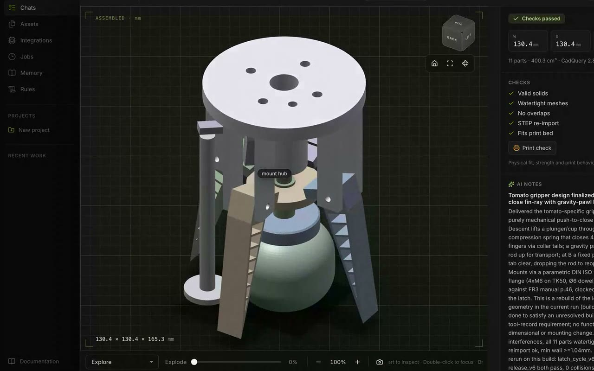
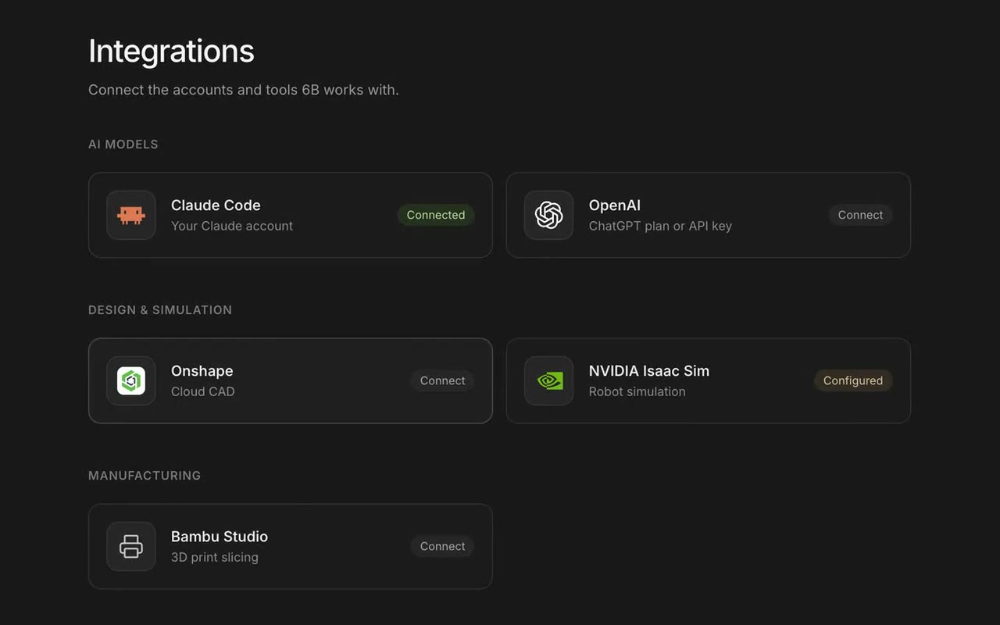

# 6B frontend

The 6B workspace in the browser: chats that stream a model's work as it happens, a WebGL 3D
studio for checking and adjusting designs, and pages for files, integrations, rules and memory.
It's built with React 19 and Vite.



<table>
  <tr>
    <td width="50%"></td>
    <td width="50%"></td>
  </tr>
  <tr>
    <td align="center"><sub>Studio: checks, measurements, explode, AI notes</sub></td>
    <td align="center"><sub>Integrations: models, CAD, simulation, printing</sub></td>
  </tr>
</table>

## Develop

Needs Node.js 20+. Start the [backend](../backend/README.md) on port 8765 first, then:

```sh
npm --prefix frontend install
npm --prefix frontend run dev
```

Open the URL Vite prints. `/api` and `/openapi.json` proxy to `127.0.0.1:8765`
([vite.config.js](vite.config.js)), and edits reload instantly.

| Script | Does |
|---|---|
| `npm run dev` | Vite dev server with the API proxy |
| `npm run build` | Production build to `dist/`, which the backend serves |
| `npm test` | Node unit tests, then the Vitest + Testing Library suite |
| `npm run check` | Tests and build, as `./verify.sh` runs them |
| `npm run format` | Prettier |

## What's where

| Path | What it is |
|---|---|
| `src/App.jsx` | Shell: routing, sidebar, sign-in, capabilities, modals |
| `src/TaskPage.jsx`, `src/AgentTrace.jsx` | A chat: live trace, questions, plan approvals, follow-ups |
| `src/ui.jsx` | Shared pieces, including the composer |
| `src/ModelPicker.jsx` | Model choice and the reasoning-effort slider panel |
| `src/ArtifactPreview.jsx`, `src/AssemblyStudio.jsx`, `viewer.js` | File previews and the WebGL assembly studio |
| `src/ParameterPanel.jsx`, `src/VersionCompare.jsx` | Design sliders and version diffs |
| `src/EvidencePanel.jsx`, `src/ExecutionSummary.jsx` | Sources, decisions, delivery checks |
| `src/PickPlacePanel.jsx`, `src/SimulationPanel.jsx`, `src/PrintabilityPanel.jsx` | Pick-and-place, Isaac Sim, print checks |
| `src/ModelConnection.jsx`, `src/OnshapeSetup.jsx`, `src/BambuSetup.jsx` | Integration setup |
| `src/lib.js` | API client, browser-held connections, formatting helpers |
| `src/auth.js` | Google sign-in through Firebase, loaded only when the server enables it |
| `docs.html`, `docs.js` | The `/docs` API reference, generated from OpenAPI |
| `styles.css`, `workspace.css`, `studio.css`, … | Theme tokens and layouts |

## How it talks to the backend

- **Snapshots and streams.** Pages read REST snapshots, then follow `/api/tasks/{id}/events` over
  server-sent events and resume from the last event ID after a drop.
- **Hosted connections.** On the hosted site, the visitor's provider, model, reasoning effort and
  API key live in this browser (this tab only, unless they choose to remember it). They're sent as
  `X-6B-*` headers. The key goes only with requests that start a run.
- **No runtime CDN.** Fonts, icons and libraries are bundled, so the app works offline against a
  local backend.

## Design

A charcoal-and-green theme in the style of NVIDIA Brev, with a sidebar-and-workspace layout.
Color tokens live in `styles.css`. Sidebar, collection and responsive layouts live in
`workspace.css`. Motion respects `prefers-reduced-motion`.

## Deploy

[`Dockerfile`](Dockerfile) builds the app, then [Caddy](Caddyfile) serves `dist/` and proxies
`/api/*` to `BACKEND_URL`. Set it to the API's private address, e.g.
`http://backend.railway.internal:8080`. Server-sent events are flushed immediately, and hashed
assets are cached for a year. On Railway, set the service's root directory to `/frontend`.

## Credits

[Lucide](https://lucide.dev/guide/react) icons ·
[LobeHub Icons](https://github.com/lobehub/lobe-icons) for Claude Code and OpenAI logos (MIT) ·
the Onshape mark from onshape.com, used to identify the service ·
[DiceBear Avataaars](https://www.dicebear.com/styles/avataaars/) avatars ·
[FormKit AutoAnimate](https://auto-animate.formkit.com/) ·
[Inter](https://fontsource.org/fonts/inter) via Fontsource.
